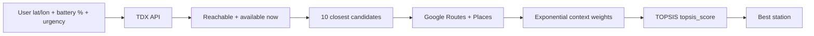

# AI — EV Charging Station Recommendation (Taiwan)

University final-project code for **ranking and explaining EV charging stations** in Taiwan. The active pipeline uses **TDX** (Transport Data eXchange) for station metadata, live availability, and pricing, plus **Google Maps** for road distance and nearby points of interest. Optional **Gemini** explanations live in `llm.py` (not wired into `logic.py` by default).

---

## Quick reference

| Item | Value |
|------|--------|
| **Domain** | EV charging station recommendation |
| **Geography** | Taiwan (city-scoped via TDX, e.g. `Taipei`) |
| **Primary goal** | Given user location + battery %, find reachable stations with free connectors, score them, pick the best |
| **Ranking** | **TOPSIS** with exponential, battery-aware weights (distance, cost, availability) |
| **Primary sort key** | `topsis_score` (closeness coefficient ∈ [0, 1]) |
| **Auxiliary score** | `total_score` — weighted sum using the same dynamic weights (breakdown columns) |
| **Main entry point** | `python logic.py` from `Algorithm/` |
| **Secrets** | `AI/.env` (gitignored) |

---

## How it works



1. **Battery range** — remaining drive distance is estimated from battery %, full range (default 300 km), and a safety factor (default 0.8).
2. **Context weights** — exponential curves shift priority by battery level and urgency (`is_available_now`). Low battery emphasises distance and free connectors; high battery emphasises cost. Urgent users get a fixed override vector.
3. **TDX fetch** — stations, live connector status, and charging rates for the chosen city.
4. **Filter** — keep stations within range that have at least one connector available now (`ConnectorStatus == 1`). Falls back to all reachable stations if none are free.
5. **Shortlist** — take the 10 closest by straight-line distance (limits paid Google API calls).
6. **Enrich** — road distance (Routes API), cost (TDX rates), live connector counts. After ranking, each station gets a `nearby_pois` list (Places API New) for the map — POIs are display-only and do not affect the score.
7. **Rank** — **TOPSIS** (`topsis_score`) is the primary sort key. A weighted-sum `total_score` with the same dynamic weights is also computed for transparency.

### User context states

| State | Condition | Weight behaviour |
|-------|-----------|------------------|
| **URGENT** | `is_available_now=True` | Fixed weights: dist 0.60, cost 0.05, pots 0.35 |
| **LOW BATTERY** | battery &lt; 20% | Survival curves dominate (distance + availability) |
| **MID BATTERY** | 20% ≤ battery &lt; 50% | Blend of survival and comfort |
| **HIGH BATTERY** | battery ≥ 50% | Comfort curve dominates (cost) |

When urgent, stations with zero available connectors receive a large distance penalty so they rank last without being dropped from results.

---

## Project layout

```
AI/
├── README.md                 ← you are here
├── .env                      ← API keys (gitignored; see Environment)
├── .venv/                    ← Python virtual environment
│
├── Algorithm/                ← active Taiwan recommender
│   ├── logic.py              ← Calculation_Model + TOPSIS + recommend() pipeline
│   ├── API.py                ← TDX OAuth client (stations, live status, rates)
│   ├── get_Distance_EV.py    ← Google Routes API (road distance)
│   ├── get_POI.py            ← Google Places API (New) — nearby POI (map display only)
│   ├── get_cache.py          ← POI response cache helper
│   ├── llm.py                ← Gemini draft → critique → final explanation (standalone)
│   └── final_recommendations_summary.csv   ← output from logic.py main()
│
└── archive/                  ← legacy US / Palo Alto code (reference only)
    ├── README.md
    └── legacy_us/            ← old models, notebooks, ev_pathfinder, ChargePoint data
```

**Do not use `archive/` for new development** unless you explicitly need the old Palo Alto stack. Consider adding `AI/archive/**` to `.cursorignore` to keep AI agents from loading legacy context.

---

## Setup

### 1. Virtual environment

```powershell
cd AI
python -m venv .venv
.\.venv\Scripts\Activate.ps1
pip install pandas numpy requests python-dotenv google-genai rich
```

(`rich` is optional — enables coloured terminal tables in `logic.py`; a plain-text fallback is used if missing.)

### 2. Environment variables

Create `AI/.env`:

```env
GOOGLE_MAPS_API_KEY=your_google_maps_key
GEMINI_API_KEY=your_gemini_key          # optional; only for llm.py
TDX_CLIENT_ID=your_tdx_client_id
TDX_CLIENT_SECRET=your_tdx_client_secret
```

| Key | Used by | Purpose |
|-----|---------|---------|
| `GOOGLE_MAPS_API_KEY` | `get_Distance_EV.py`, `get_POI.py` | Routes API + Places API (New) |
| `GEMINI_API_KEY` | `llm.py` | Natural-language recommendation explanation |
| `TDX_CLIENT_ID` / `TDX_CLIENT_SECRET` | `API.py`, `logic.py` | TDX OAuth2 client credentials |

**TDX:** register at [tdx.transportdata.tw](https://tdx.transportdata.tw) and create API keys in the member center.  
**Google:** enable **Routes API** and **Places API (New)** for the same key.

---

## Running

### Full recommendation pipeline

```powershell
cd AI\Algorithm
python logic.py
```

This runs the Taipei demo (user near Taipei Main Station, 35% battery), writes `final_recommendations_summary.csv`, and prints a ranked table with TOPSIS scores and dynamic weights.

### Programmatic use

```python
from logic import Calculation_Model

user_location = (25.0478, 121.5170)   # (lat, lon)
battery_percent = 35.0

model = Calculation_Model(
    user_location,
    battery_percent,
    is_available_now=False,   # True when the user cannot wait
    city="Taipei",
)
ranked = model.recommend()

best = ranked.iloc[0]
print(best["station_name"], best["topsis_score"], best["total_score"])

# Inspect the weight vector used for this run
print(model.weights)  # WeightVector(w_distance=..., w_cost=..., w_pots=...)
```

### Test TDX only

```powershell
cd AI\Algorithm
python API.py
```

### Test distance / POI helpers

```powershell
python get_Distance_EV.py
python get_POI.py
```

---

## Scoring (`Algorithm/logic.py`)

### Criteria

| Criterion | TOPSIS column | Weighted-sum column | Source | Better direction |
|-----------|---------------|---------------------|--------|------------------|
| Distance | `distance` | `distance` | Google Routes API (metres) | Lower |
| Cost | `cost` | `cost` | TDX `ChargingRate` (median per station) | Lower |
| Availability | `available_pots` | `available_points` | TDX `ConnectorLiveStatus` (idle count) | Higher |

### Dynamic weights

Weights are computed by `get_exponential_weights()` from battery fraction and urgency:

```text
w_dist_raw  = 0.10 + 0.60 × exp(-7.0 × B)
w_pots_raw  = 0.15 + 0.30 × exp(-7.0 × B)
w_cost_raw  = 0.40 × (1 - exp(-4.0 × B))
```

(`B` = clamped battery fraction in [0, 1]; raw values are normalised to sum to 1.0.)

When `is_available_now=True`, the fixed urgency vector `[0.60, 0.05, 0.35]` (`[distance, cost, pots]`) is used instead.

Access at runtime via `model.weights` or the `contrib_*` columns on the output DataFrame.

### TOPSIS (`topsis_rank`)

1. Build decision matrix `[distance, cost, available_pots]`.
2. Vector-normalise columns, apply dynamic weights.
3. Compute ideal (PIS) and anti-ideal (NIS) solutions (cost criteria minimised; benefit criteria maximised).
4. Closeness coefficient `topsis_score = S_neg / (S_pos + S_neg)` — higher is better.

Results are sorted **descending** by `topsis_score`.

### Weighted sum (`total_score`)

An auxiliary breakdown using min–max normalisation and the same dynamic weights. Output includes `n_dist`, `n_cost`, `n_avail` and `contrib_*` columns. Useful for explaining trade-offs; **ranking uses TOPSIS**.

### Nearby POIs (display only)

POIs are **not** part of the score. After ranking, `recommend()` attaches a `nearby_pois` list to every station so the map can draw them around the station pin. Each entry has `name`, `type`, `lat`, `lon`, `address`, `rating`, `review_count`, `walk_distance_m`, `open_now` and `maps_uri`, sorted nearest first (`poi_count` is just the list length).

To load POIs around any station pin (not only recommended ones), call `GET /pois?lat=..&lng=..` on the FastAPI service, or `GET /api/pois?lat=..&lng=..` on the Express backend.

### TDX city codes

Pass English enum values to `city=`, e.g. `Taipei`, `NewTaipei`, `Taichung`, `Kaohsiung`. Full list is in `API.TDX_CITIES`.

---

## External APIs

### TDX (`API.py`)

| Endpoint | Purpose |
|----------|---------|
| `/v1/EV/Station/City/{City}` | Station name, lat/lon, spaces |
| `/v1/EV/ConnectorLiveStatus/City/{City}` | Live connector availability |
| `/v1/EV/ChargingRate/City/{City}` | Charging prices |
| `/v1/EV/ParkingRate/City/{City}` | Parking prices (wrapped; not yet in scoring) |

Auth: OAuth2 client credentials → Bearer token (auto-refreshed in `TDXClient`).

### Google Maps

| Module | API | Notes |
|--------|-----|-------|
| `get_Distance_EV.py` | Routes API `computeRoutes` | `DRIVE`, traffic-aware; very short trips may omit `distanceMeters` (fallback to straight-line in `logic.py`) |
| `get_POI.py` | Places API (New) `places:searchNearby` | Coffee shops, restaurants, malls, parks within 500 m |

---

## LLM explanations (`llm.py`)

Standalone module for natural-language justification via Gemini. It is **not** called from `logic.py` `main()` today; wire it up manually if needed:

```python
from llm import run_reflection_pipeline, print_reflection_report

# Build a payload from ranked DataFrame rows (station name, distance, cost, etc.)
reflection = run_reflection_pipeline({
    "recommended": {...},
    "alternatives": [{...}, ...],
})
print_reflection_report(reflection)
```

Requires `GEMINI_API_KEY`. Ranking works without it.

---

## Archive (`archive/legacy_us/`)

Previous iteration targeted **Palo Alto, CA** with:

- ChargePoint session CSVs and unit-price tables  
- Model A / Model B wait-time prediction (availability + duration)  
- `ev_pathfinder` Flask web UI  
- US holiday / weather feature engineering  

That code is kept for reference and comparison. The Taiwan pipeline replaces wait-time ML with **live TDX connector counts** and replaces static US price CSVs with **TDX charging rates**.

---

## Known limitations

- **Cost comparison** — TDX rates can be per-kWh, per-minute, or free; scoring uses a simplified median per station (prefers per-kWh rates).
- **Battery model** — linear `% × range` estimate; not tied to a specific vehicle yet.
- **API quota** — full `recommend()` calls TDX once per run plus ~20 Google calls (10 routes + 10 POI searches).
- **Routes edge case** — degenerate ~0 s routes may lack `distanceMeters`; straight-line fallback is used.

---

## License / attribution

TDX data is provided by Taiwan MOTC under their platform terms. Google Maps and Gemini usage are subject to Google API terms. See course/university requirements for project licensing.
