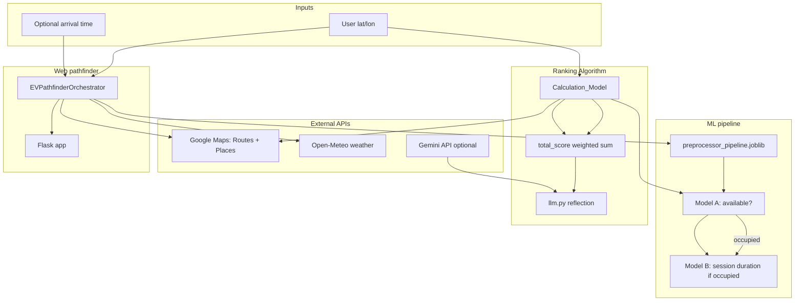

# AI — EV Charging Station Recommendation

University final-project code for **ranking and explaining EV charging stations** in the Palo Alto area. The system combines **Google Maps APIs** (road distance, nearby POI), **machine-learning wait-time prediction** (two-stage models), **unit-price cost data**, and optional **Gemini LLM** explanations.

---

## Quick reference (for humans and AI agents)

| Item | Value |
|------|--------|
| **Domain** | EV charging station recommendation |
| **Geography** | Palo Alto, CA (bounding box in `ev_pathfinder/config.py`) |
| **Primary goal** | Score stations by distance, POI, predicted wait, and cost; pick the best option |
| **Wait-time formula (orchestrator)** | `T_total = T_travel + T_wait` |
| **Ranking formula (`Algorithm/logic.py`)** | Weighted sum of min–max normalized POI, distance, wait, cost (default weights 0.25 each) |
| **Python package to run web UI** | `ev_pathfinder` (`python -m ev_pathfinder`) |
| **Batch ranking + LLM demo** | `python logic.py` from `Algorithm/` |
| **Training** | `Time Series Forecast.ipynb` and/or `time_series_forecast.py` |
| **Secrets** | `.env` at repo root or `AI/` (see [Environment](#environment)) |

### Entry points

| Command | CWD | What it does |
|---------|-----|----------------|
| `python -m ev_pathfinder` | `AI/` | Flask app on port 5000 — map UI + `/api/predict` |
| `python logic.py` | `AI/Algorithm/` | Batch pipeline: distance → POI → wait → `total_score` → CSV + LLM reflection |
| `python llm.py` | `AI/Algorithm/` | Standalone Gemini reflection demo (needs `GEMINI_API_KEY`) |
| `python time_series_forecast.py` | `AI/` | Train/export Model A artifacts (notebook migration) |

### Two inference stacks (important)

The repo maintains **two parallel implementations** of Model A/B inference. They are similar but use **different model directories**:

| Stack | Config | Models live in | Use when |
|-------|--------|----------------|----------|
| **Recommendation / ranking** | `Algorithm/config.py` | `AI/Algorithm/model/`, `AI/Algorithm/model_B/` | `Calculation_Model` in `logic.py`, batch CSV export |
| **Pathfinder orchestrator** | `ev_pathfinder/config.py` | `AI/model/`, `AI/model_B/` | Web app, `find_best_station`, LSTM sequence context |

Both expect `preprocessor_pipeline.joblib` next to their config root (`Algorithm/` vs `AI/`). After retraining, copy artifacts to **both** locations or align `config.py` paths.

---

## Architecture



**Model A** — binary availability (0 = available, 1 = occupied). If predicted available → wait = 0.  
**Model B** — regression on session length in **seconds** when occupied.  
**LSTM** — optional sequence of last 12 sessions (`ev_pathfinder/sequence_builder.py`); uses `data/sequence_history_cache.pkl` when a timestamp is selected.

---

## Directory map

```
AI/
├── README.md                 ← you are here
├── .env                      ← GOOGLE_MAPS_API_KEY, GEMINI_API_KEY (gitignored)
├── preprocessor_pipeline.joblib   ← used by ev_pathfinder (root copy)
│
├── Algorithm/                ← scoring, APIs, LLM, self-contained models
│   ├── logic.py              ← Calculation_Model: POI, distance, wait, total_score
│   ├── llm.py                ← Gemini draft → critique → final explanation
│   ├── config.py             ← paths → Algorithm/model*, data/*
│   ├── get_Distance_EV.py    ← Google Routes API (road distance, meters)
│   ├── get_POI.py            ← Google Places API (nearby POI)
│   ├── get_cache.py          ← POI / sequence caches
│   ├── model_a.py, model_b.py, preprocessing.py
│   ├── model/, model_B/      ← pickles + LSTM for Algorithm stack
│   └── preprocessor_pipeline.joblib
│
├── ev_pathfinder/            ← Flask orchestrator + web UI
│   ├── orchestrator.py       ← T_travel + T_wait, find_best_station
│   ├── app.py                ← routes: /, /api/stations, /api/predict, /api/health
│   ├── routing.py, weather.py, stations.py, sequence_builder.py
│   ├── model_a.py, model_b.py, preprocessing.py  ← mirror of Algorithm
│   └── requirements.txt
│
├── model/, model_B/          ← pickles + LSTM for ev_pathfinder stack
├── data/                     ← CSVs, GeoJSON, caches, notebooks
├── Time Series Forecast.ipynb
├── time_series_forecast.py   ← OOP training script (Model A focus)
└── *.ipynb                   ← exploratory / cost / other experiments
```

---

## Scoring (`Algorithm/logic.py`)

### Criteria

| Criterion | Column | Source | Better direction |
|-----------|--------|--------|------------------|
| Distance | `distance` | `get_Distance_EV` (road meters) | Lower |
| POI | `poi_sum` | `get_POI` + `POI_score` | Higher |
| Wait | `waiting_time` | Model A → Model B (seconds) | Lower |
| Cost | `cost` | `data/unit_price_by_station_palo_alto.csv` or row `fee` | Lower |

Default weights on `Calculation_Model`: `w_dist`, `w_poi`, `w_wait`, `w_cost` = **0.25** each.

`total_score()` min–max normalizes each factor, applies weights, sorts **descending** by `total_score`.

### POI score (per place, then summed)

```text
poi_score = (rating × log10(reviews + 1)) / (1 + distance_meters / 100)
```

### Required columns before `total_score()`

```text
poi_sum, distance, waiting_time, cost
```

Pass `include_llm_context=True` to add `llm_context` JSON per row for `llm.run_reflection_pipeline()`.

### Wait-time input schema

Same features as training (`data/Final_Cleaned_Dataset.csv`), without labels `Availability` / `Total_Duration_Secs`:

- `MAC Address`, `temp`, `precip`, `clouds`, `Plug Type` or `Plug Type Encoded`, `fee`
- Time fields, or omit and pass `at_time=datetime(...)`

```python
from datetime import datetime
from logic import Calculation_Model

user_location = (37.4419, -122.1430)  # (lat, lon)
model = Calculation_Model(user_location)
wait_secs = model.predict_waiting_time(row_dict, at_time=datetime.now(), return_minutes=False)
```

---

## Web orchestrator (`ev_pathfinder`)

Loads Palo Alto stations from cleaned ChargePoint data, fetches live weather, runs Model A/B (+ LSTM when `selected_time` is set), and computes driving time via Google Routes.

**REST API** (`POST /api/predict` JSON body):

| Field | Required | Description |
|-------|----------|-------------|
| `user_lat`, `user_lon` | yes | WGS84 |
| `mode` | no | `"single"` (default) or `"find_best"` |
| `station_mac` | single mode | Station MAC address |
| `selected_time` | no | ISO-8601; enables 12-step LSTM history |

**Run:**

```bash
cd AI
pip install -r ev_pathfinder/requirements.txt
# also install: tensorflow (LSTM), scikit-learn, xgboost, joblib, google-genai (for Algorithm/llm only)
python -m ev_pathfinder
```

Open `http://localhost:5000`. Health check: `GET /api/health`.

---

## LLM explanations (`Algorithm/llm.py`)

Optional layer on top of ranked results:

1. **Draft V1** — short justification  
2. **Critique** — self-check for hallucinations / tone  
3. **Final V2** — revised text  

Requires `GEMINI_API_KEY` in `.env`. Model fallback chain is defined in `MODEL_FALLBACK_CHAIN` inside `llm.py`.

`logic.py` `main()` runs ranking with `include_llm_context=True`, then calls `run_reflection_pipeline()` on the top station vs alternatives.

---

## Machine learning artifacts

### Model A (`model/` or `Algorithm/model/`)

| File pattern | Role |
|--------------|------|
| `best_xgb_model.pkl`, `best_rf_model.pkl`, `best_dt_model.pkl`, `best_lr_model.pkl` | Availability classifiers |
| `lstm.pkl` | Sequence availability (ev_pathfinder LSTM path) |

### Model B (`model_B/` or `Algorithm/model_B/`)

| File pattern | Role |
|--------------|------|
| Same `best_*` names | Duration regressors |
| `lstm_duration.keras`, `lstm.keras`, `lstm.pkl` | LSTM duration variants |

### Training

| Asset | Produces |
|-------|----------|
| `Time Series Forecast.ipynb` | Experiments → save to `model/` / `model_B/` |
| `time_series_forecast.py` | CLI/OOP pipeline for Model A training |
| `data/Final_Cleaned_Dataset.csv` | Cleaned supervised set |
| `data/ChargePointData2011-2020-ManullyPreCleaned3.csv` | Raw sessions |

`AVAILABILITY_THRESHOLD` (default `0.5`) is in both `config.py` files — see comments for classifier vs LSTM semantics.

---

## Data files

| Path | Purpose |
|------|---------|
| `data/Final_Cleaned_Dataset.csv` | Training / inference feature schema |
| `data/ChargePointData2011-2020-ManullyPreCleaned3.csv` | Raw ChargePoint sessions |
| `data/unit_price_by_station_palo_alto.csv` | Median $/kWh by station name → `cost` |
| `data/chargers.geojson` | Station map layer |
| `data/poi_cache.json` | Cached Places API results |
| `data/sequence_history_cache.pkl` | LSTM sequence history |
| `Algorithm/final_recommendations_summary.csv` | Output of `python logic.py` |

---

## Environment

Create `.env` (gitignored) in the project root or `AI/`:

```env
GOOGLE_MAPS_API_KEY=...    # Routes + Places (Algorithm + ev_pathfinder)
GEMINI_API_KEY=...         # Optional; Algorithm/llm.py only
```

Weather uses **Open-Meteo** (no key).

Suggested install (from `AI/`):

```bash
python -m venv .venv
.venv\Scripts\activate          # Windows
pip install -r ev_pathfinder/requirements.txt
pip install tensorflow xgboost google-genai scikit-learn joblib pandas numpy requests python-dotenv
```

---

## Common tasks (agent playbook)

1. **Re-rank stations from Python** — `cd Algorithm`, build DataFrame with lat/lon per station, run `process_distances` → `process_all_stations` → `process_waiting_times` → `total_score`.
2. **Debug one station wait** — `predict_waiting_time(..., return_details=True)` on `Calculation_Model`.
3. **Change scoring weights** — edit `w_*` on `Calculation_Model` instance before `total_score()`.
4. **Retrain models** — notebook or `time_series_forecast.py`, then copy pickles into both `model/` trees.
5. **Fix “model not found”** — check which stack you run (`Algorithm` vs `ev_pathfinder`) and that `preprocessor_pipeline.joblib` sits beside that stack’s `config.py`.
6. **Add natural-language explanation** — rank with `include_llm_context=True`, pass row `llm_context` to `llm.generate_ev_explanation` or `run_reflection_pipeline`.

---

## Roadmap / known gaps

- [x] Road-following distance (Google Routes)
- [x] POI scoring
- [x] Two-stage wait prediction (Model A + B)
- [x] Cost from unit-price CSV
- [x] LLM reflection pipeline (`llm.py`)
- [x] Flask pathfinder with `find_best` mode
- [ ] Full production wait times for arbitrary station lists without manual weather/feature rows
- [ ] Battery / SUMO range filter before scoring (commented in `logic.py` header)
- [ ] Unify duplicate `model*` folders and `Algorithm` vs `ev_pathfinder` code paths
- [ ] Align target formula docs with any future weight changes

---

## License and context

Academic final project — EV station recommendation using ChargePoint historical data and Google APIs. Station coverage and bounds are configured for **Palo Alto** unless datasets and `PALO_ALTO_BOUNDS` are changed.
